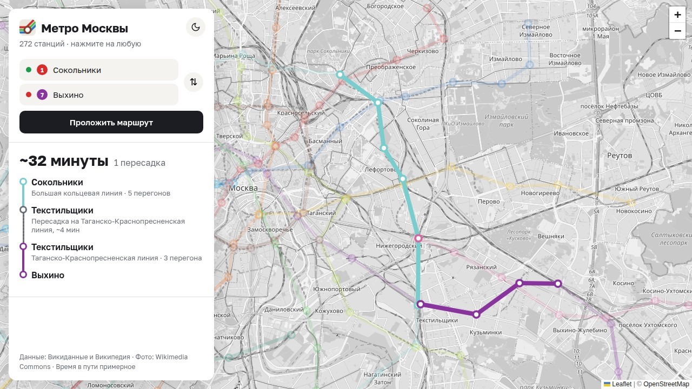
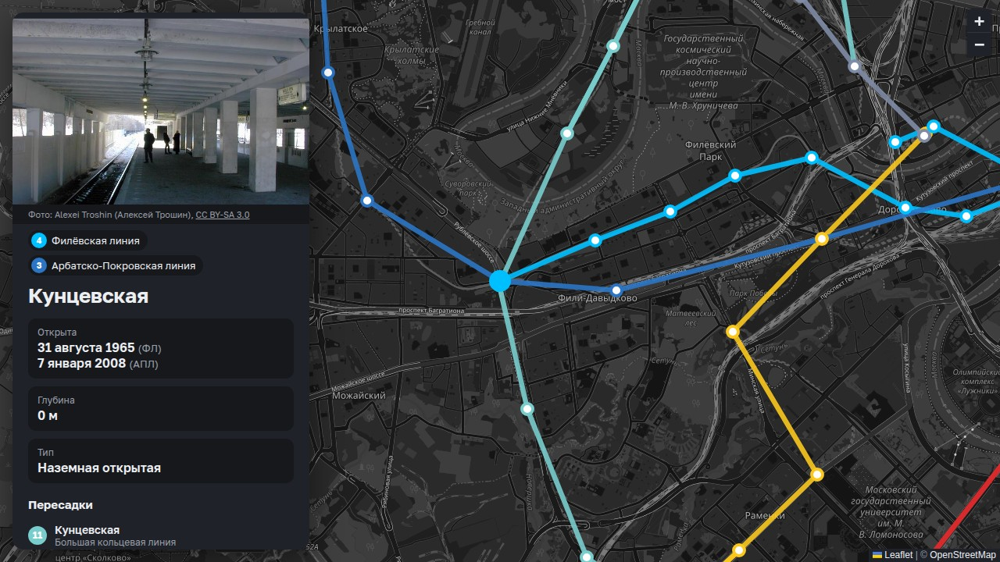

# 🚇 Метро Москвы — интерактивная карта



Карта московского метро на настоящей карте города. На ней 272 станции и 16 линий (без МЦК и МЦД).
Нажмите на станцию, чтобы узнать о ней подробности, или проложите маршрут между двумя станциями.

## Что умеет

- **Карточка станции:** фото, дата открытия, глубина, тип, история названий и пересадки.
  У кросс-платформенных станций (Кунцевская, Парк Победы…) показаны даты открытия обеих линий, у реконструированных (Каховская, Варшавская…) — дата повторного открытия.
- **Маршрут** с пересадками и примерным временем в пути. Линия маршрута рисуется на карте от начала к концу, а шаги появляются в списке по мере того, как она до них доходит.
- **Поиск станции** со значками линий. Ищет и по старым названиям: «Выставочная» найдёт «Деловой центр».
- **Подсказки «в какой вагон садиться».** Открытых данных об этом нет, поэтому подсказки вносятся вручную в `data/cars.json`.
- **Светлая и тёмная темы.** Тема подстраивается под настройки компьютера, а по кнопке переключается кругом от кнопки, как в Telegram.
- **Плавная карта.** При перелёте между станциями не появляются серые пустые места, а карту нельзя увести дальше Московской области.



## Как запустить

Нужен Python 3.

```bash
python3 -m venv venv
venv/bin/pip install -r requirements.txt
venv/bin/python app.py
```

Откройте http://localhost:8000.

Сайт работает на Flask: маршруты считает сервер. Поэтому просто открыть `index.html` в браузере не получится.

## Структура

```
app.py                 сервер: отдаёт данные и считает маршрут (алгоритм Дейкстры)
templates/index.html   разметка страницы
static/map.js          карта, карточка станции, поиск, маршрут, темы
static/style.css       стили; цвета светлой и тёмной темы — переменные в начале файла
static/logo.svg        логотип и значок вкладки
data/stations.json     станции и линии (собирается скриптом)
data/manual.json       ручные правки данных — важнее того, что пришло из интернета
data/cars.json         подсказки «в какой вагон садиться»
tools/fetch_data.py    скрипт, который собирает stations.json из Викиданных, Википедии и Commons
```

## Данные и лицензии

- Станции и линии — [Викиданные](https://www.wikidata.org) (CC0), глубина, тип и старые названия — [Википедия](https://ru.wikipedia.org) (CC BY-SA 4.0).
- Фото станций — [Wikimedia Commons](https://commons.wikimedia.org). Автор и лицензия каждого фото указаны под ним в карточке.
- Карта города — © участники [OpenStreetMap](https://www.openstreetmap.org/copyright), библиотека карты — [Leaflet](https://leafletjs.com).
- Значки солнца и луны — [Lucide](https://lucide.dev) (ISC).

Время в пути примерное: оно считается по расстоянию между станциями, а не по расписанию.
